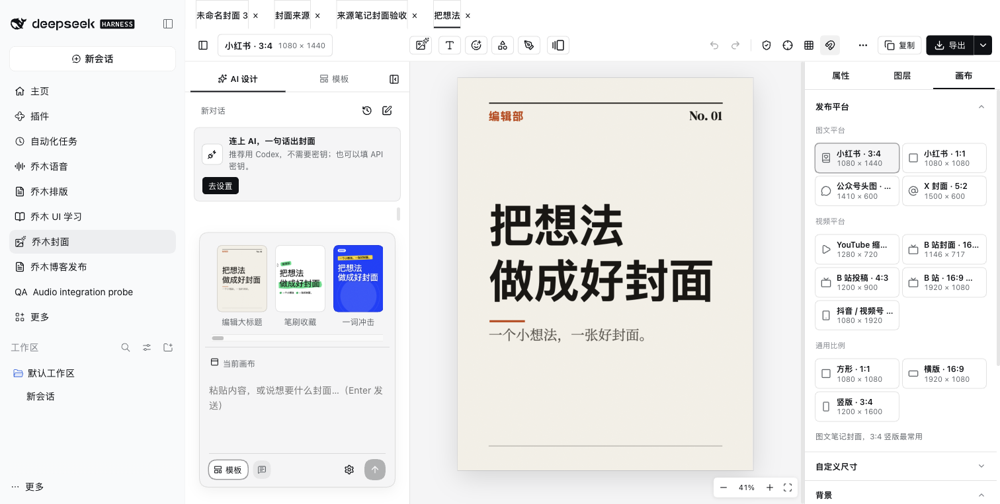
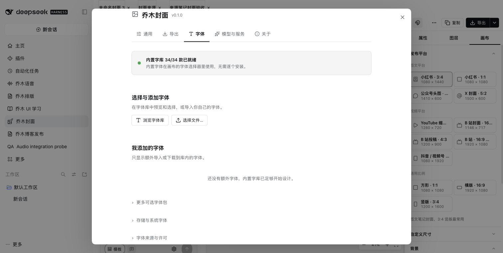

# Qiaomu Cover Design for DeepSeek Harness

> v0.1.2: DeepSeek Harness **0.2.1-rc.3** compatibility update. [Release verification](docs/RC3-COMPATIBILITY.md).

[中文](README.md)

Turn notes, ideas and images into covers using the original Qiaomu canvas, templates, typography, layers, AI design panel and export dialogs.



## Features

- Original Fabric editor: text, shapes, images, freehand drawing, layers, groups, alignment, guides, safe zones and undo/redo.
- 46 templates and 12 platform sizes; A/B variants, saved style series and layout/color tools.
- 34 default fonts downloaded with integrity checks, a 74-font catalog, optional packs and local font import.
- Multiple `.qcover` projects and Markdown source notes, autosave, conflict protection and restored tabs.
- Original AI conversations, local edits, history and branched canvases. Image generation continues when another Harness panel is open; results remain in the gallery.
- Uploaded/generated images, local folders and Unsplash, with search, filters, rename and delete.
- PNG/JPEG/WebP at 1×/2×/3×, quality/size controls and transparent selection export. Save to workspace, source-note or system folders, embed in notes and update the `cover` property.
- Qiaomu Home integration, keyboard shortcuts, Chinese/English and light/dark themes.



## Install

Requires Harness `0.2.1-rc.3` (`<0.3.0`) and Node.js 22+.
Download the tgz and SHA256SUMS from [Releases](https://github.com/joeseesun/qiaomu-cover-design-dsh/releases), verify the checksum and install through Plugin Manager or:

```sh
dsh plugin --profile desktop add /absolute/path/qiaomu-cover-design-dsh-0.1.2.tgz
```

Open Qiaomu Cover Design in the sidebar. Choose More → New cover, enter a title and select a template. Edit objects in the inspector, then export. Collapse the left panel to see the canvas on narrow windows.

## Migration and storage

The More menu imports projects/notes/assets, whole workspace folders and original `data.json` settings. Folder imports preserve relative paths; duplicate names get numbered. Original files remain untouched. Include source notes, fonts and referenced assets. Files are limited to 64 MB.

Default workspace: `$DSH_HOME/qiaomu/qiaomu-cover-design-dsh/workspace`, with `~/.dsh` as the default DSH_HOME. Configure absolute `notesDir` and `dataDir` paths to select a workspace or state directory. Fonts, gallery and jobs live under `QiaomuCoverData`; removed project files go to `.trash`.

API keys use macOS Keychain, Windows DPAPI or Linux Secret Service rather than plaintext state. Linux needs `secret-tool` and an active Secret Service. Reconnect account authorization in the new host. The original Models & Services screen supports existing providers; DeepSeek uses `deepseek-flash`. Codex connections need its CLI. Configured AI services may charge for requests you initiate.

Desktop clients use Harness's folder chooser. Browser clients enter an absolute path on the Harness host. Local system fonts and clipboard depend on host permissions. Unsplash requires your own configuration and applicable photo licensing.

## Validation

152 tests cover original business logic, real canvas template layout, image jobs, OAuth/Codex protocols, storage conflicts, credentials and network/path boundaries. Independent Harness QA exercises editing, undo, note writeback, three image formats, background generation, local gallery, fonts, light/dark and 720px layout.

AI and account protocols were tested with local fixtures, without paid model calls or real account sign-in. Windows/Linux credential storage and physical mobile touch are not device-tested. See the [migration record](docs/ADAPTATION.md).

```sh
npm ci
npm run check
npm pack
```

Template layout tests require the native `canvas` dependency; CI checks that it is available.

MIT. Adapted from [Qiaomu Cover Design](https://github.com/joeseesun/qiaomu-cover-design), commit `c56bb742eecc0c9f6bbd419c598060aa99d5410f`. Original CSS is retained, with separate Harness host boundaries. See [third-party notices](THIRD_PARTY_NOTICES.md).
